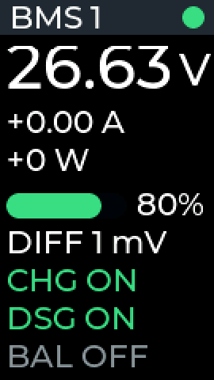
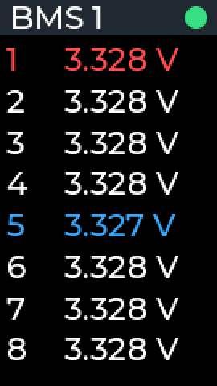
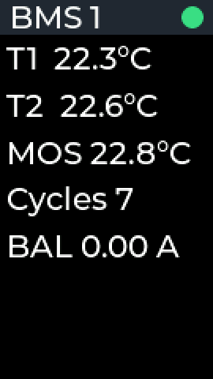
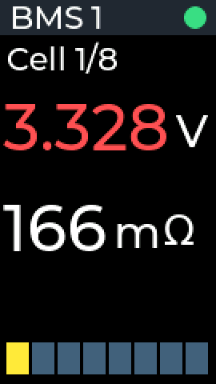
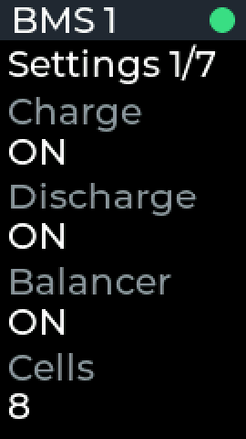
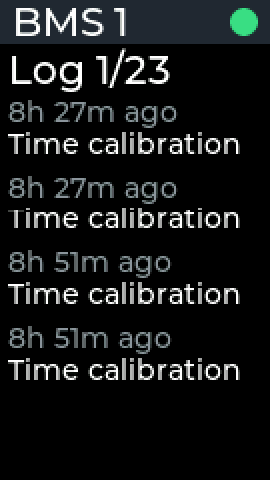
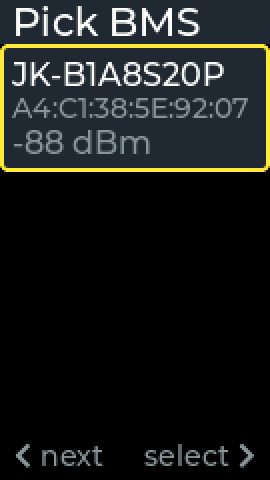

# JK BMS monitor on LILYGO T-Display

ESP-IDF firmware for the LILYGO TTGO T-Display that reads
JK BMS units over Bluetooth LE, shows them on the display and uploads their status
to a small web dashboard.

The BLE protocol is ported from [esphome-jk-bms](https://github.com/syssi/esphome-jk-bms).

## Screens

Left button: previous page. Right button: next page. Hold left for 1.5 s to pick
another BMS.

| Summary | All cells | Pack | Cell |
|:---:|:---:|:---:|:---:|
|  |  |  |  |
| Pack voltage, current, power, state of charge, the largest cell voltage difference, charge / discharge / balancer state | Voltage of every cell, highest in red, lowest in blue | Temperatures, charge cycles, balancing current | Voltage and resistance of one cell, the selected cell in the bar chart |

| Errors | Settings | Log | Sleep |
|:---:|:---:|:---:|:---:|
|  |  |  |  |
| Active BMS alarms (empty when there are none) | BMS settings: switches, protection voltages, currents, temperatures | The last 50 events of the BMS logbook, newest first | Shown for 2 s before deep sleep; a button press cancels it |

| Pick BMS | Connecting |
|:---:|:---:|
|  |  |
| Shown when several BMS are around or after holding the left button | While searching and connecting; errors appear below the spinner |

The header turns red and blinks while a BMS reports an active error.

## How it works

- **Picking a BMS.** At the first boot the board searches for JK BMS advertisements. A single
  BMS is selected automatically, several are listed. The choice is saved to flash.
- **Reading.** The BMS is connected once per wakeup and read: the BMS beeps on every command,
  so the firmware sends as few as possible.
- **Sleep.** After 30 s without a button press the board goes to deep sleep. Either button
  wakes it up.
- **Upload.** Every 60 s the board wakes up with the display off, reads the BMS, POSTs the
  status as JSON over Wi-Fi and goes back to sleep. The settings and the logbook are sent
  with every 10th upload.

## Dashboard

[`web/`](web) is a small Flask app that receives the uploads and shows them after a login:
pack values, cells, settings, the full logbook (kept beyond the 50 events the BMS stores)
and a 48 h chart. See `web/start.sh` and `web/restart.sh` for running it with gunicorn.

## Building

ESP-IDF 5.5, target `esp32`:

```sh
idf.py build flash monitor
```

Secrets are not part of this repository. `main/CMakeLists.txt` reads them from
`../secrets/jkbms/firmware.env` (environment variables with the same names take precedence):

```sh
ENV_JKBMS_UPLOAD_URL=http://<server>:<port>/api/status
ENV_JKBMS_API_TOKEN=<token, same as JKBMS_API_TOKEN of the dashboard>
ENV_JKBMS_WIFI_SSID=<Wi-Fi where the board runs>
ENV_JKBMS_WIFI_PASS=<password>
```

The dashboard reads `JKBMS_API_TOKEN`, `JKBMS_WEB_USER`, `JKBMS_WEB_PASSWORD` and `SECRET_KEY`
from `web/.env`.

### Screenshots

The screenshots above are taken from the device itself: build with
`CONFIG_UI_SCREENSHOT_CONSOLE=y` and run

```sh
python tools/screenshots.py /dev/ttyACM0 docs/screenshots
```

The BMS name and MAC address in the pick list are replaced with made-up ones.
